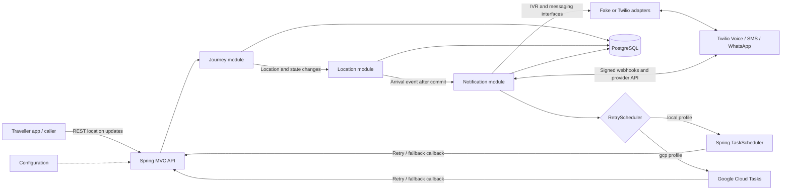
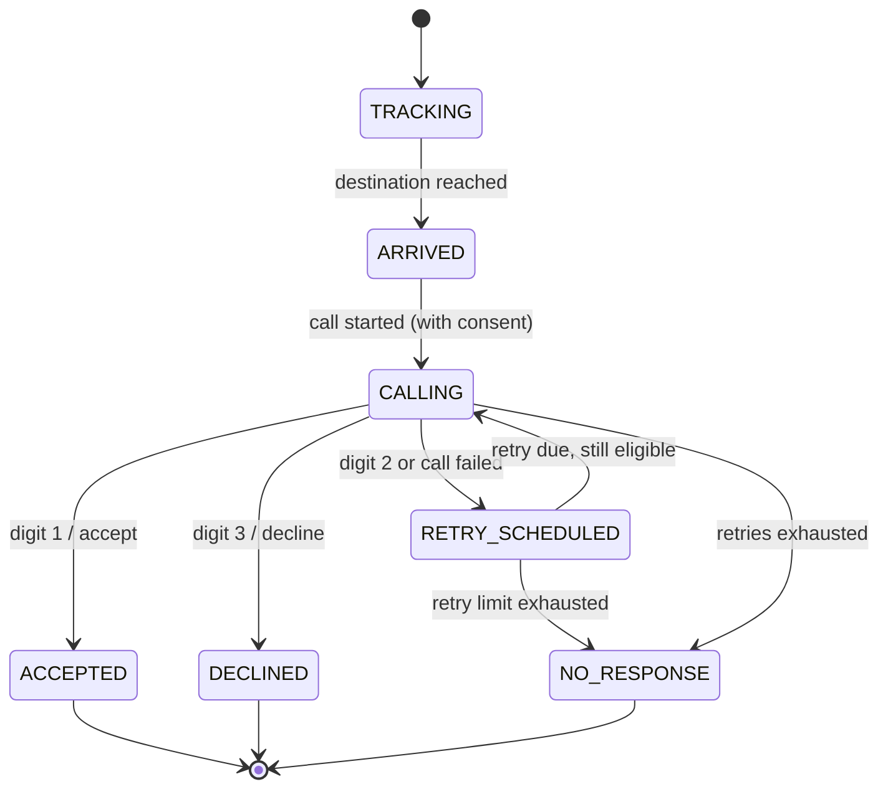

# Journey Assistant

Journey Assistant tracks a traveller's location during a bus journey. When a location update places the traveller inside the destination geofence, the service can start an automated IVR call. The traveller can accept a ride link, request another call in five minutes, or decline further calls for the journey. Outbound calls and messages require notification consent.

The MVP is a Java 21, Spring Boot 3 modular monolith backed by PostgreSQL and Flyway. Twilio call and messaging integrations are implemented; fake providers are the defaults for local development. Retries use Spring scheduling locally and Cloud Tasks with the `gcp` Spring profile. Exotel, ride booking, and payment integrations are future work.

## Architecture



The package root is `com.journeyassistant`. Domain and application code lives in `journey`, `location`, and `notification`; HTTP controllers and DTOs live in `api`; cross-cutting wiring lives in `config`. Database changes are applied by Flyway migrations, with Hibernate set to validate the schema.

## Journey state machine



The retry limit defaults to three retries after the first call. Scheduled work rechecks journey state and consent before acting. Duplicate webhook deliveries are idempotent; declined journeys are not called again.

## Requirements

- Java 21 and Maven 3.9+.
- Docker with Docker Compose for local PostgreSQL, or a compatible PostgreSQL database.
- Twilio credentials and a public HTTPS webhook URL only when exercising live Twilio integrations. The default fake providers make no provider calls.

## Run locally

Copy the local environment template, set a private database password, then start PostgreSQL from the repository root. Docker Compose reads `.env` automatically, and Spring imports the same file when you run the app from the repository root. Shell environment variables take precedence over values in `.env`.

```bash
cp .env.example .env
# Edit .env and set a private POSTGRES_PASSWORD before starting the database.
docker compose up -d postgres
```

Run the application. Flyway applies migrations at startup; the default `local` profile uses in-process retry scheduling and fake provider adapters.

```bash
mvn spring-boot:run
```

The API listens on `http://localhost:8080`. To run the test suite and package verification:

```bash
mvn clean verify
```

Interactive API documentation is available at [http://localhost:8080/swagger-ui.html](http://localhost:8080/swagger-ui.html); the OpenAPI JSON is at `/v3/api-docs`. Use **GET `/api/v1/journeys/{journeyId}/provider-references`** in Swagger UI after triggering a call or message to fetch the latest call SID and available message SIDs. Swagger displays the IDs in the response; it does not automatically insert response values into a different operation's form.

Stop the database when finished:

```bash
docker compose down
```

Compose stores PostgreSQL data in a named volume. Set `POSTGRES_DB`, `POSTGRES_USER`, `POSTGRES_PASSWORD`, or `POSTGRES_PORT` in `.env` to configure the local database. The application connection can be overridden with `DATABASE_URL`, `DATABASE_USERNAME`, and `DATABASE_PASSWORD`. The populated `.env` file is ignored by Git; do not commit it.

### Configuration

Common environment variables:

| Variable | Default / purpose |
|---|---|
| `IVR_PROVIDER` | `fake` or `twilio`; default `fake`. |
| `IVR_MAX_RETRIES` | `3` retries after the initial call. |
| `IVR_SIGNATURE_VALIDATION_ENABLED` | `false` for fake providers; enable it when using Twilio. Signed webhooks with invalid/missing signatures receive 403. |
| `NOTIFICATION_PROVIDER` | `fake` or `twilio`; default `fake`. |
| `NOTIFICATION_STRATEGY` | `sms`, `whatsapp`, `whatsapp_then_sms`, or `both`; default `sms`. |
| `WHATSAPP_FALLBACK_TIMEOUT` | `60s` default before WhatsApp-to-SMS fallback. |
| `RIDE_LINK` | URL inserted into the outbound ride message. |
| `TWILIO_ACCOUNT_SID`, `TWILIO_AUTH_TOKEN` | Twilio credentials; keep out of source control. |
| `TWILIO_FROM_NUMBER`, `TWILIO_SMS_FROM`, `TWILIO_WHATSAPP_FROM` | Voice, SMS, and WhatsApp senders as applicable. |
| `TWILIO_WHATSAPP_CONTENT_SID` | Optional approved WhatsApp template content SID. |
| `TWILIO_TRIAL_MODE` | `true` omits optional Twilio callback and WhatsApp template parameters for trial accounts; default `false`. |
| `SWAGGER_ENABLED` | Enables Swagger UI and OpenAPI docs; defaults to `true` for local development. Set to `false` in production if the docs should be hidden. |
| `PUBLIC_BASE_URL` | Public HTTPS origin of this application used for Twilio voice/status webhooks and signature validation. This is not a Twilio API URL. |

For Cloud Tasks, activate the `gcp` profile and configure `GCP_PROJECT_ID`, `GCP_TASKS_LOCATION`, `GCP_TASKS_QUEUE`, `GCP_TASKS_INVOKER_SERVICE_ACCOUNT`, and `PUBLIC_BASE_URL`. See the [deployment guide](docs/deploy.md). For Twilio trial setup, WhatsApp sandbox, and manual checks, see [Twilio setup](docs/twilio-setup.md).

## API examples

Create a journey. Consent defaults to `false` if omitted; set it to `true` only when the traveller has provided consent for calls and messages.

```bash
curl -i -X POST http://localhost:8080/api/v1/journeys \
  -H 'Content-Type: application/json' \
  -d '{
    "userPhone": "+14155550123",
    "destinationLatitude": 37.7749,
    "destinationLongitude": -122.4194,
    "geofenceRadiusMeters": 250,
    "notificationConsent": true
  }'
```

The response includes a `journeyId` and initial `TRACKING` state. Use that ID in subsequent calls:

```bash
JOURNEY_ID='<journey-uuid>'

curl -i -X POST "http://localhost:8080/api/v1/journeys/${JOURNEY_ID}/locations" \
  -H 'Content-Type: application/json' \
  -d '{
    "latitude": 37.7750,
    "longitude": -122.4195,
    "timestamp": "2026-11-03T10:15:00Z"
  }'

curl -i "http://localhost:8080/api/v1/journeys/${JOURNEY_ID}"

# Fetch call/message provider IDs for webhook testing
curl -i "http://localhost:8080/api/v1/journeys/${JOURNEY_ID}/provider-references"
```

The location response contains `distanceToDestinationMeters`, the new `state`, and `arrivedNow`. If the update falls within the radius, the journey transitions from `TRACKING` to `ARRIVED`; with consent enabled, arrival handling can initiate the IVR flow.
The provider-references endpoint returns the latest call SID and any SMS/WhatsApp message SIDs recorded for the journey. The REST Client file uses this response to populate its webhook request variables.

## Twilio webhooks

Twilio callbacks are exposed under `/webhooks/twilio/`. The app passes its `/voice?journeyId=...` URL to Twilio when creating an outbound call; Twilio then fetches TwiML and posts keypad input to `/gather`. Configure `PUBLIC_BASE_URL` as the app's public HTTPS origin (for local development, the current ngrok origin), and enable signature validation. An unsigned manual REST Client request to `/voice` while validation is enabled is expected to return 403. If a real call is silent and logs show a rejected `/voice`, compare Twilio's Request Inspector URL with the configured origin and verify the runtime auth token belongs to the calling account/subaccount. See [Twilio setup and 403 troubleshooting](docs/twilio-setup.md#troubleshoot-a-403-or-a-silent-call). Other endpoints are `/status`, `/message-status`, and `/whatsapp/inbound`. Internal retry and fallback callbacks use `/internal/tasks/**`; see [deployment security notes](docs/deploy.md#6-deploy-and-verify) before exposing the service.

## Future work

- **Voice conversation with an LLM:** Replace or extend the fixed digit menu with a conversational voice flow that can understand natural-language intent, handle clarifying questions, and safely map intent to the existing journey transitions.
- **Ride booking integration:** Add a provider adapter to request a ride, return a booking/deep link, and track booking outcomes after acceptance.
- **Payment integration:** Add a payment provider adapter for fare estimates, payment authorization/collection, and payment status updates with appropriate consent and security controls.
